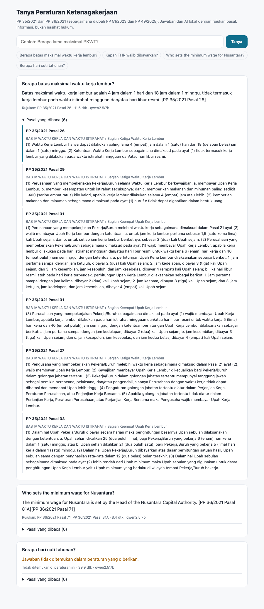

# Tanya Peraturan: a RAG assistant for Indonesian employment regulations

[](https://github.com/dinulimann/rag-regulations/actions/workflows/ci.yml)

Ask questions about Indonesian employment rules in Indonesian or English. Answers are built from the **text currently in force** of
**PP 35/2021** (fixed-term contracts, outsourcing, working hours, termination) and **PP 36/2021** (wages), as amended by
**PP 51/2023** and **PP 49/2025**. Every answer cites the article it comes from, and a question the regulations don't answer is
refused instead of guessed. Everything runs locally: embeddings, database and language model.



## Results

30 hand-labelled questions: 25 answerable (20 in Indonesian, 5 in English) and 5 deliberately outside these regulations, such as
annual leave days (set in the Manpower Law, not here), maternity leave length, BPJS contributions, income tax and the 2026 Jakarta minimum wage.
Generator `qwen2.5:7b` and embeddings `bge-m3`, both through Ollama on a 16 GB laptop ([full table](eval/results.md)):

| | First version | After the fixes below |
|---|---:|---:|
| Right article retrieved (top 6) | 25/25 | **25/25** |
| Key facts correct in the answer | 23/25 | **25/25** |
| Right article cited | 21/25 | **23/25** |
| Out-of-scope questions refused | 4/5 | **5/5** |
| Citations to an article that wasn't retrieved | 4 | **0** |

What the first run showed, and what changed ([first run](eval/results-v1.md)):

- **A dangerous hallucination.** Asked how long maternity leave is, the model answered "2 days". PP 36/2021 Pasal 40 lists
  "istirahat sebelum dan sesudah melahirkan" without a length, and "2 days" belongs to a different case nearby. The prompt now
  says that a similar but different case, or a topic listed without the number asked for, is not an answer. The question is now refused.
- **Wrong article numbers in citations** ("Pasal 3" for Pasal 15, "PP 36/2025"). The validator already kept them off the screen,
  because every cited article must be one that was retrieved. The model now cites short tags (`[S2]`) that code turns into article
  labels, which a small model copies far more reliably.
- **One mistake was in the test set, not the system.** A question about hours *per day* also required "40 hours per week" in the
  answer. The criterion was corrected and the change is marked in `eval/questions.yml`.
- **Still imperfect:** for the 75% basic-wage rule the model states the fact correctly but cites the 2nd and 3rd sources instead of
  the 1st (Pasal 7). This is reported as a miss, not tuned away for the test.

Speed: an answer takes **about 8–12 s once the models are loaded**. The evaluation averaged 51 s per question because, on a 16 GB laptop
also running Docker, the embedding and chat models are swapped in and out of memory between questions.

## The hard part: getting the law right

### 1. Messy official PDFs
The JDIH BPK PDFs are scans. PP 36/2021 has no text layer at all, and the others read "2O2I", "PRES I DEN", "Pasal t7" and "Pasal 26E}".
The base regulations were therefore taken from **peraturan.go.id**, whose files have a clean digital text layer. Only the two amendments exist as
scans everywhere, so the parser repairs them:
- article numbers: `2l → 21`, `t7 → 17`, `26E} → 26B`, and `351 → 35I` when Pasal 351 can't exist;
- paragraph numbers: `(41 → (4)`, `l2l → (2)`;
- page furniture: running headers, page numbers, and "continued on next page" lines;
- a short list of words the OCR misreads, found by reading the output.

The CI downloads all six PDFs, verifies their SHA-256 and checks that the parsed corpus is unchanged.

### 2. Amendments: answering from the version in force
An amending regulation doesn't repeat the law. It lists changes: "Ketentuan Pasal 27 diubah sehingga berbunyi…", "Di antara Pasal 35
dan Pasal 36 disisipkan 10 pasal…", "Pasal 26A dihapus." [`rag/consolidate.py`](rag/consolidate.py) applies PP 51/2023 and then
PP 49/2025 to PP 36/2021:
- **changed articles:** 39 changed or inserted in total;
- **deleted articles:** Pasal 26A was inserted in 2023 and deleted in 2025;
- **new chapters:** BAB XIIIA, with the Nusantara minimum wage;
- **new sections:** Bagian Keempat and Kelima, on sectoral minimum wages;
- **changed explanations:** explanations rewritten by the amendments replace the old ones.

Each article keeps its history ("diubah oleh PP 49/2025"), which the answer and the interface show. Every instruction was checked against the
amendment text: all 24 changes of PP 51/2023 and all 23 of PP 49/2025.

### 3. Chunks that follow the law's structure
There is one chunk per article, with its chapter and section and its official explanation. Long articles are split at paragraphs or numbered items,
and each part keeps its heading. The result is 183 chunks from 172 articles in force.

## How it answers

```
question ─► bge-m3 embedding ─► pgvector (cosine) ─┐
         └► PostgreSQL full-text ('indonesian') ───┴► reciprocal rank fusion ─► top 6 articles
         └► "Pasal 27 PP 36/2021" in the question ─► fetched directly, put first
top 6 + rules ─► qwen2.5:7b ─► answer with [S1] tags ─► tags → article labels, citations checked
```

- **Hybrid search.** Vectors catch paraphrases and English questions; full-text catches exact terms such as "PKWT" or "alih daya".
- **Rules for the model:**
  - answer only from the sources, in the question's language;
  - give the exact numbers;
  - mention amendments;
  - start with `NOT_FOUND` when the sources don't answer.
- **Plain text, capped length.** Ollama's JSON mode made the 7B model loop on whitespace for over 10 minutes on one question, so answers are
  plain text and the citations and refusal are read from it.
- **Citations are validated.** A cited article must be one of those retrieved; anything else is reported and never shown as a source.

## Run it

```bash
python -m venv .venv && .venv/bin/pip install -r requirements.txt     # also needs poppler (pdftotext)
ollama pull bge-m3 && ollama pull qwen2.5:7b
docker compose up -d --wait                                            # PostgreSQL + pgvector on :5562
.venv/bin/python -m rag.corpus                                         # download (checksums), parse, consolidate → data/corpus.jsonl
.venv/bin/python -c "from pathlib import Path; from rag import store; store.index(Path('data/corpus.jsonl'))"
.venv/bin/uvicorn rag.api:app --port 8000                              # http://localhost:8000
.venv/bin/python -m eval.run                                           # eval/results.md
.venv/bin/pytest                                                       # 20 tests
```

API: `POST /api/ask {"question": "..."}` returns `found`, `answer`, `citations`, `unsupported_citations`, and the `sources` with their amendment history.

## Limits

- **Two regulations only.** The Manpower Law itself (UU 13/2003 as amended by the Job Creation Law) and ministerial regulations, such as the
  THR rules, are not included, so questions about them are refused.
- **Formulas in the amendments are damaged by OCR.** The minimum-wage formula in PP 51/2023 and 49/2025 reads like "UM6*1y = UM61 + …" in
  the scans. Quote formulas from the official PDF, not from the answer.
- **The 7B model still mis-cites now and then** (see above). A larger or cloud model would likely do better, but has not been measured yet.
- This is legal information, not legal advice.

Sources: [peraturan.go.id](https://peraturan.go.id) (Kemenkumham). Laws and regulations are not subject to copyright in Indonesia
(UU 28/2014 Pasal 42). The corpus built from them is in `data/corpus.jsonl`.
